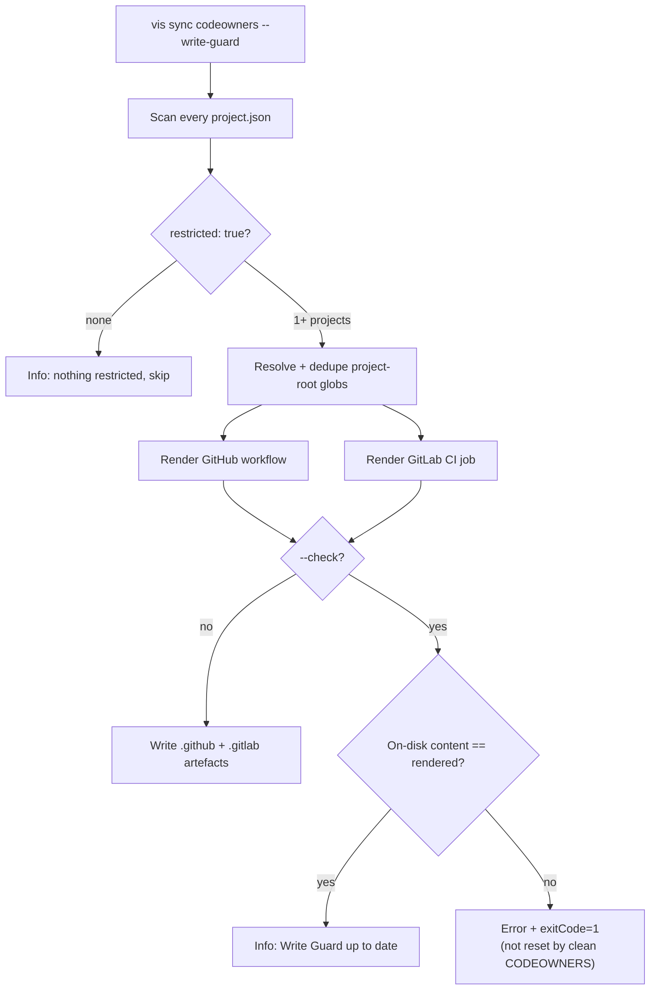

# vis sync

Generates workspace-wide artefacts that are derived from per-project configuration.

## Usage

```bash
vis sync <kind> [options]
```

## Kinds

### codeowners

Aggregates `owners` entries from every project's `project.json` into a single `CODEOWNERS` file.

```bash
vis sync codeowners                           # Write to <workspace>/CODEOWNERS
vis sync codeowners --out=.github/CODEOWNERS  # Custom output path
vis sync codeowners --check                   # Verify file is up to date (CI guard)
vis sync codeowners --write-guard             # Also emit Write Guard CI (GitHub + GitLab)
vis sync codeowners --write-guard --check     # CI: fail if Write Guard files drift
```

#### project.json owners

Each project declares its code owners:

```json
{
    "$schema": "https://unpkg.com/@visulima/vis/schemas/project.schema.json",
    "owners": [
        { "path": "src/**", "owners": ["@myorg/core-team"] },
        { "path": "docs/**", "owners": ["@myorg/docs-team"], "channel": "#docs-reviews" }
    ]
}
```

#### vis.config.ts codeowners block

```typescript
export default defineConfig({
    codeowners: {
        orderBy: "project-id", // or "file-source" (default)
        provider: "github", // "github" | "gitlab" | "bitbucket" | "other"
        globalPaths: {
            "/.github/**": ["@myorg/platform"],
            "/pnpm-workspace.yaml": ["@myorg/infra"],
        },
    },
});
```

#### Write Guard (`--write-guard`)

`--write-guard` is opt-in. On top of generating `CODEOWNERS`, it emits CI for
projects flagged `restricted: true` in their `project.json`. Two artefacts are
written so the guard works on both forges, scoped to the restricted project
roots only — unrelated changes are never blocked.

> **The two forges enforce at different strengths — this is deliberate.** The
> GitHub workflow is a **hard gate**: it fails the PR check when a restricted
> path changed without code-owner approval. The GitLab job is a **soft guard**:
> GitLab CI cannot portably gate a merge on code-owner _approval_ from a job, so
> it only verifies CODEOWNERS freshness. **Real enforcement on GitLab requires
> enabling the native protected-branch _"Require approval from Code Owners"_
> setting (GitLab Premium / Ultimate)** — the generated `.gitlab` file says this
> loudly in both a header comment and its own job log so it can't be mistaken
> for a blocking check.

| Forge  | Output path                         | Strength       | Mechanism                                                                                                                                       |
| ------ | ----------------------------------- | -------------- | ----------------------------------------------------------------------------------------------------------------------------------------------- |
| GitHub | `.github/workflows/write-guard.yml` | **Hard gate**  | `pull_request` workflow gated on restricted paths, delegates to the `geritol/write-guard` action (fails the check without approval)             |
| GitLab | `.gitlab/write-guard.gitlab-ci.yml` | **Soft guard** | Includable MR-gated job; verifies CODEOWNERS is in sync + loudly flags the change. Needs the native CODEOWNERS-approval setting for a real gate |

Opt a project in via its `project.json`:

```json
{
    "$schema": "https://unpkg.com/@visulima/vis/schemas/project.schema.json",
    "restricted": true,
    "owners": [{ "path": "src/**", "owners": ["@myorg/security"] }]
}
```

`include` the GitLab file from your root `.gitlab-ci.yml` **and** enable the
native protected-branch _"Require approval from Code Owners"_ setting — the CI
job alone is advisory until you do. With `--write-guard --check`, CI exits
non-zero if either generated file drifts from what the current `restricted` set
would produce — a clean `CODEOWNERS` does **not** reset that failure. When no
project is flagged `restricted: true`, the flag no-ops with an informational
message.

Upstream references: the GitHub workflow delegates to the
[`geritol/write-guard`](https://github.com/marketplace/actions/write-guard)
action; both forges build on native CODEOWNERS approval —
[GitHub CODEOWNERS](https://docs.github.com/en/repositories/managing-your-repositorys-settings-and-features/customizing-your-repository/about-code-owners)
and [GitLab Code Owners](https://docs.gitlab.com/ee/user/project/codeowners/).



### ci-workflow

Generates a CI workflow that runs your targets at the same time. Settings come from `ci.workflow` in `vis.config.ts`; re-run the command after changing them, and add `vis sync ci-workflow --check` to CI to catch a stale file.

```bash
vis sync ci-workflow                             # Write .github/workflows/vis-ci.yml
vis sync ci-workflow --provider=github,gitlab    # Also write .gitlab/vis-ci.gitlab-ci.yml
vis sync ci-workflow --check                     # CI: exit 1 if a generated file is stale
```

```ts
// vis.config.ts
export default defineConfig({
    ci: {
        workflow: {
            targets: ["lint", "build", "test"], // default: whichever of lint, typecheck, lint:types, build, test exist
            partitions: { test: 3 }, // split test into 3 shards that run at the same time
            providers: ["github", "gitlab"], // default: ["github"]
            affected: true, // default: only affected projects (`vis ci`); false runs every project (`vis run`)
            buildFirst: true, // default: build runs before targets dependsOn does not order relative to it
            branches: ["main"], // default: [defaultBase ?? "main"]
            nodeVersion: "22",
            runsOn: "ubuntu-latest",
        },
    },
});
```

Targets are grouped by `dependsOn`: a target waits for the listed targets it depends on (directly, through `^target`, or through targets you did not list), and the rest of a group runs at once. With `buildFirst` (the default), `build` also runs before every listed target that `dependsOn` leaves unordered relative to it: most workspaces never declare that `test` or `typecheck` needs the dependencies' `dist`, because a sequential job built first anyway. Set `buildFirst: false` once `dependsOn` says what needs `build`.

**GitHub Actions** gets one job that uses [parallel steps](https://docs.github.com/actions/reference/workflows-and-actions/workflow-syntax#jobsjob_idstepsparallel):

1. install once,
2. `vis ci <target> --deps-only` for every target, which builds everything the targets depend on once,
3. one `parallel:` step group per target group, each step running `vis ci <target> --skip-deps` (one step per shard for a partitioned target). `--skip-deps` still hashes the dependencies, so a dependency change invalidates the cached results of what depends on it.

Step 2 is what makes step 3 safe: the parallel steps share one checkout, so two of them building or restoring the same dependency at the same time would race on its outputs. GitHub runs at most 10 steps of a group at once, so the generator rejects a group that needs more. A target whose tasks depend on the same target in other projects (`dependsOn: ["^build"]`) cannot be partitioned, because its shards would depend on each other. The task cache (`taskRunner.cacheDirectory`, by default `node_modules/.cache/vis`) is kept between runs with `actions/cache`.

**GitLab CI** has no parallel steps, so each target becomes its own job in the `test` stage, ordered with `needs:`, and a partitioned target uses `parallel: N` with `--partition=$CI_NODE_INDEX/$CI_NODE_TOTAL`. Jobs run on separate machines, so each one runs its target with its dependencies, and each job keeps its own task cache. Branch globs such as `release/*` become regex rules. The file sets no `stages:` or `workflow:`; pull it into your pipeline with:

```yaml
include:
    - local: ".gitlab/vis-ci.gitlab-ci.yml"
```

### package-json-fields

Mirrors a small set of metadata fields from the **root** `package.json` to every workspace package, so each package keeps a consistent `license`, `author`, `bugs`, `homepage`, `engines`, and `repository`. `repository.directory` is preserved per package — only `type` and `url` are copied from root.

```bash
vis sync package-json-fields                            # Mirror defaults from root → every package
vis sync package-json-fields --check                    # CI: exit 1 if any package is out of sync
vis sync package-json-fields --fields license,engines   # Override the field list for this run
vis sync package-json-fields --ignore-package-name '@scope/internal-*'
vis sync package-json-fields --format=json              # Machine-readable diff
vis sync package-json-fields --quiet                    # Only print the summary line
```

#### Default fields

`author`, `bugs`, `homepage`, `license`, `repository`, `engines`.

For `repository`, root's `type` and `url` overwrite the package's, but the package's `directory` (its subpath inside the monorepo) is kept. For every other field the root value is copied verbatim.

Fields missing from root are skipped — sync never deletes from a package. Fields already deep-equal to root are skipped — no mtime churn.

## Options

| Option                   | Default                  | Description                                                                                                                |
| ------------------------ | ------------------------ | -------------------------------------------------------------------------------------------------------------------------- |
| `--out`                  | `<workspace>/CODEOWNERS` | Output file path (codeowners only)                                                                                         |
| `--check`                | `false`                  | Exit non-zero if drift is found (no writes)                                                                                |
| `--from`                 | `project-json`           | Input sources for codeowners (comma-separated/repeatable): `project-json`, `nested-codeowners`, `package-json-maintainers` |
| `--nested-includes`      | `**/CODEOWNERS`          | Glob (repeatable) used to discover nested CODEOWNERS files (codeowners only)                                               |
| `--regeneration-command` |                          | Header instruction shown to reviewers, replacing the default note (codeowners only)                                        |
| `--preserve-block`       | `false`                  | Splice the generated block between markers in an existing file instead of overwriting (codeowners only)                    |
| `--write-guard`          | `false`                  | Also emit GitHub + GitLab Write Guard CI for `restricted: true` projects (codeowners only)                                 |
| `--fields`               |                          | Comma-separated field list to mirror (package-json-fields only). Repeatable.                                               |
| `--ignore-package-name`  |                          | Glob of package names to skip (package-json-fields only). Repeatable.                                                      |
| `--format`               | `human`                  | Output format for package-json-fields: `human` or `json`.                                                                  |
| `--quiet`                | `false`                  | Suppress per-package log lines; print only the summary (package-json-fields only).                                         |
| `--provider`             | `github`                 | CI providers to generate for (ci-workflow only): `github`, `gitlab`. Comma-separated or repeatable.                        |
